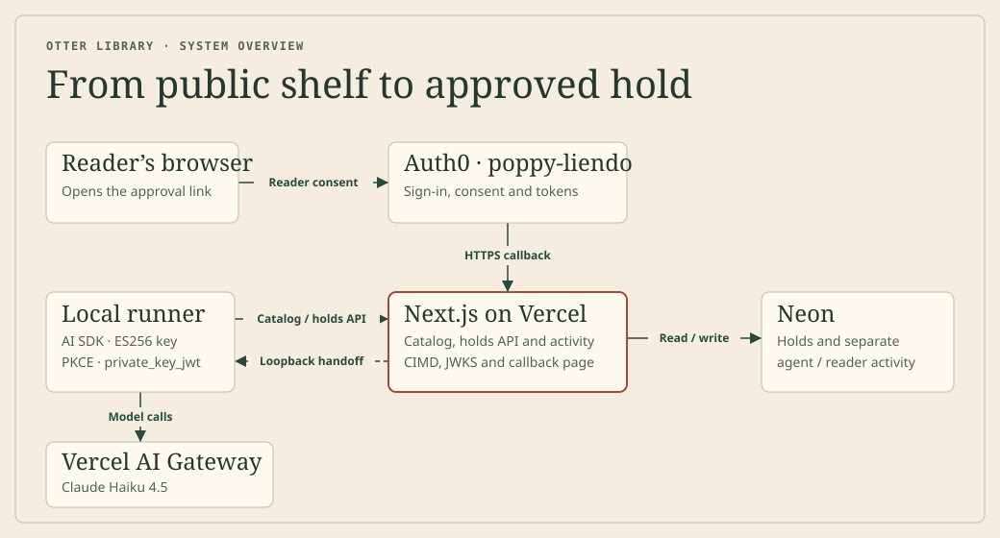

# Otter Library

**You ask. The agent browses. You approve. It reserves.**

Otter Library is a small Auth0 Poppy sample about a public bookshelf and a private library card. The agent can browse as a guest; it cannot reserve a title until a reader signs in to Auth0 and consents. **My holds** shows who reserved the title. **Activity** separates **Personal agent** from **You**.

The books and reservations are fictional. The API verifies real credentials and scopes when configured. **Coming soon:** guest holds through Anonymous Sessions and `act` claims through Agents as Principals. Neither is needed for this sample.

## Run locally

Requires Node.js 22 or later. The public shelf, catalog endpoint, and signed-out pages don't require Auth0 credentials:

```sh
npm ci
npm run dev
```

Open http://localhost:3000. Run `npm run check` to typecheck and exercise the approval path with a local issuer fixture and an AI SDK mock model. The test checks PKCE, the signed client assertion, the API challenge and scopes, and account-scoped activity. It does not contact Auth0, Neon, or Vercel AI Gateway.

## Architecture



| Where | What runs there |
| --- | --- |
| One public Next.js origin | Catalog, Auth0 reader sign-in, `/api/holds`, activity, discovery, public agent metadata and JWKS, and the HTTPS callback |
| Auth0 | Reader sign-in and user consent for `holds:write` or `holds:read` |
| Local Node runner | AI SDK with Claude Haiku 4.5 via Vercel AI Gateway, ES256 Poppy Session signing, and the PKCE verifier and private client key |
| Neon on Vercel | Durable holds and account-scoped activity. The development server can use memory without Neon. |

The local runner never deploys its private key. Auth0 sends the approval back to the site's HTTPS callback; it passes the response to the runner's one-shot loopback listener. The API verifies both the Poppy Session and the Auth0 token, checks that their client identities agree, and requires the exact operation scope for an agent. The browser uses the same holds handler with the web application's reader token.

## Run the Poppy journey

1. Follow [the Auth0 and Vercel setup](docs/setup.md). Check that the public origins and the Auth0 API identifier match your intended configuration.
2. In your local terminal, set `AGENT_ORIGIN` to the site's HTTPS origin, `AGENT_KEY_FILE` to the private key path from setup, `AGENT_ISSUER` to the exact issuer (including the trailing slash), and `AGENT_PAIRWISE_SECRET` to a stable random string of at least 32 characters. If the API identifier differs from the origin, also set `AUTH0_AUDIENCE`. Supply `AI_GATEWAY_API_KEY` or Vercel OIDC credentials privately.
3. Run `node agent/cli.mjs hold "Find me a nature book and place a hold"`. The CLI prints method, route, and status, plus fixed progress lines; it doesn't print the prompt, model response, approval URL, or credentials.
4. The public catalog returns **200** and the protected hold request returns **401** for `holds:write`. In the browser, sign in and approve that scope. The runner exchanges the code and retries the hold. The successful request returns **200**.
5. Sign into **My holds** as the same reader, then open **Activity**. Look for **Placed by agent** on the hold, **Reserved The Tide Line** in the agent lane if the agent selected that title, and **Viewed holds** in the reader lane.

## Next step: Otter Outfitters (MCP, guest carts, payments)

Continue the Otter story with [Otter Outfitters](https://github.com/focusOtter/poppy-otter-outfitters): change a book hold into a shopping trip with cart and checkout approvals. Outfitters demonstrates API-only delegation and simulated payments today. An MCP tool interface, guest carts that depend on Anonymous Sessions, and a payment-provider sandbox are follow-on exercises, not capabilities verified by the Library demo.

## License

Adapted from [Otter Outfitters](https://github.com/focusOtter/poppy-otter-outfitters) and Auth0's [Drift Bean Poppy sample](https://github.com/auth0-samples/auth0-poppy-sample). Copyright 2026 Okta, Inc. Licensed under the [Apache License 2.0](LICENSE).
